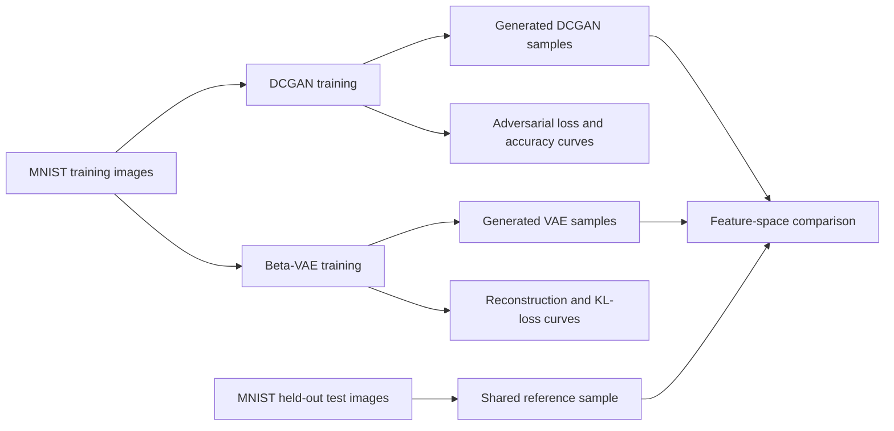

# DCGAN vs. Convolutional Beta-VAE on MNIST

A reproducible comparison of adversarial and variational generative models for handwritten-digit synthesis. The project implements a Deep Convolutional GAN (DCGAN) and a convolutional beta-VAE in TensorFlow/Keras, then evaluates their training behavior and generated samples under a shared protocol.

## Project question

How do a DCGAN and a convolutional beta-VAE differ in sample quality, reconstruction behavior, latent representation, and training dynamics when trained on the same MNIST data?

## Models

### DCGAN

- 100-dimensional Gaussian noise input
- Transposed-convolution generator with batch normalization and LeakyReLU activations
- Convolutional discriminator with dropout
- Binary cross-entropy adversarial objective
- Separate Adam optimizers for generator and discriminator

### Convolutional beta-VAE

- Convolutional encoder and transposed-convolution decoder
- 16-dimensional latent representation
- Reparameterization trick for differentiable sampling
- Binary cross-entropy reconstruction loss with KL regularization
- `beta = 2` in the final configuration

## Evaluation design



Both models use the same held-out real-image reference set and sample count during feature-space evaluation. Random seeds are fixed for repeatability.

The notebook uses ImageNet-pretrained InceptionV3 features as a practical comparative measure. Because MNIST is grayscale and substantially different from ImageNet, the resulting scores should be interpreted only as an internal comparison between these runs, not as universal benchmark values.

## Repository structure

```text
.
|-- notebooks/
|   `-- dcgan_vs_beta_vae_mnist.ipynb
|-- .gitignore
|-- requirements.txt
`-- README.md
```

## Installation

```bash
git clone https://github.com/Hamidreza4p/generative-models-mnist-comparison.git
cd generative-models-mnist-comparison

python -m venv .venv
```

Activate the environment:

```bash
# Linux/macOS
source .venv/bin/activate

# Windows PowerShell
.\.venv\Scripts\Activate.ps1
```

Install dependencies:

```bash
python -m pip install --upgrade pip
pip install -r requirements.txt
```

## Run the experiment

```bash
jupyter lab notebooks/dcgan_vs_beta_vae_mnist.ipynb
```

Run the notebook from top to bottom. The first execution downloads MNIST and the InceptionV3 feature-extractor weights. A GPU is strongly recommended for the full 100-epoch configuration.

For a short pipeline check, set `EPOCHS = 2` and `FID_SAMPLES = 500` in the configuration cell. Use the default values for the final experiment.

## Reproducibility improvements

The portfolio version corrects several weaknesses in the original coursework notebook:

- TensorFlow is the only deep-learning framework used.
- NumPy and TensorFlow random seeds are fixed.
- GAN noise batches follow the current real batch size.
- The configured VAE optimizer is actually passed to `compile`.
- Both models use the same held-out reference images during evaluation.
- Unsupported experimental claims and historical metrics are omitted.
- Generated notebook output is excluded to keep the repository reviewable.

## Limitations

- MNIST is an introductory benchmark and does not establish performance on complex image-generation tasks.
- A single training run does not quantify run-to-run variance.
- InceptionV3 features are not domain-specific to handwritten digits.
- A stronger follow-up would report repeated runs and add a digit-classifier embedding metric, KID, and mode-coverage analysis.

## Author

Developed by **Hamidreza Sadeghzadeh**.


